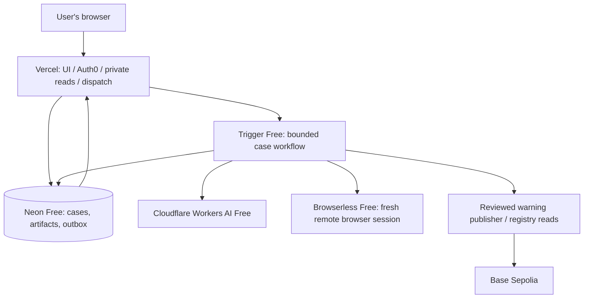

# Scamwin: all-online, zero-spend Vercel amendment

Date: 8 November 2026. Status: accepted budget/provider baseline used by the implemented prototype, following the user's requirements: everything must be free, the website should use Vercel, and no laptop/local investigation worker may be required. Real-service acceptance and deployment remain pending. See the [current consolidated plan and feature gaps](../../scamwin-current-plan.md).

This amendment takes precedence over provider, deployment, model, storage and scheduling choices in the [implementation plan](2026-11-08-scamwin-web-app.md) and [design](../specs/2026-11-08-scamwin-web-app-design.md). Their evidence, ownership, consent, risk, isolation and correction requirements remain. This document began as a planning amendment; the current Scamwin adapters now follow these provider choices. No account balance, remote deployment or successful live integration is established by that implementation.

## 1. What zero spend means

Target a non-commercial hackathon prototype that runs online within recurring free allowances. Do not use a paid tier, purchased balance, paid trial, auto-recharge, or mainnet funds. Do not promise unlimited traffic, permanent vendor availability, hardened arbitrary-malware browsing, or production SLA at zero cost. When a free allowance is exhausted, pause the affected work and explain the reset/unavailability; never silently activate paid usage or substitute a fixture for a live result.

Use the included `vercel.app` address; a purchased custom domain is unnecessary. Vercel Hobby is limited to personal non-commercial use and has resource quotas. A future commercial product requires a new hosting/terms decision. Keep Vercel workloads within its terms: UI, accounts, DB access, status and ordinary provider API integrations. Do not run a scraper, penetration test, target proxy or headless target browser on Vercel. Offloading a workload does not by itself establish approval for every possible product use.

## 2. Revised stack

| Component | New choice | Free boundary |
| --- | --- | --- |
| Web app | Vercel Hobby, existing Next/React/TypeScript, Node 24 | Personal/non-commercial and published platform quotas; no Pro upgrade |
| Authentication | Existing Auth0 Free | Published free account/feature limits; no paid add-ons |
| Database | Neon Free | Published free compute/storage limits; verify the actual demo project's current allowance and remain on Free |
| Small evidence artifacts | Existing Neon, private prepared raster images stored as validated base64 text | Strict artifact/case caps and 7-day artifact expiry; not an unlimited file store |
| AI | Cloudflare Workers AI Free, direct standard-inference REST API | 10,000 Neurons/day; provider rejects further work after Free quota |
| Initial model candidate | `@cf/meta/llama-4-scout-17b-16e-instruct` | Documented vision/function support; verify account/model access before enabling |
| Background orchestration | Trigger.dev Free | Recurring $5/month included usage allowance; stop at Free limit, no paid upgrade |
| Remote browser | Browserless Cloud Free, Playwright connection/fixed adapter | 1,000 units/month, 2 concurrent browsers, 2-minute session cap; no card required per pricing |
| Blockchain | Base Sepolia and a limited public RPC/faucet | Free test ETH subject to faucet/API limits; no purchased ETH or mainnet use |
| Monitoring | Existing sanitized application/provider logs | No required paid monitoring plan or content replay |

Remove the planned dependency on paid Render compute, OpenAI API billing, Daytona funding/network tiers and an R2/S3 account. Do not use Firecrawl or a paid external threat feed as a required dependency. OpenMods UI/Auth0/Drizzle patterns are reused; its existing generic chat/tool runtime is not automatically compatible with the new budget mode.

These are published allowances, not confirmed account balances. Actual sign-up eligibility, available regions, model/browser API access and deployment terms must be verified without assuming that a credit card, top-up or paid subscription is available.

## 3. All-online execution

No laptop must stay online. Browserless supplies remote browsers; Trigger supplies finite workflow execution. Vercel hosts the website but is not the sandbox or scanner. Provider API keys remain server/worker-only.

The consumer flow remains unchanged: sign in, enter the offer/action and optional screenshots, submit one private check, watch progress, read evidence and ask follow-up questions. Progress/cancellation records remain in Neon. If background execution cannot start because the free allowance is exhausted, display `quota_paused` dispatch availability with a reset message; do not leave a normal-looking indefinite queued spinner.

## 4. AI and privacy changes

Implement a provider-neutral adapter with `extractOfferIntent`, `explainAssessment` and evidence-grounded follow-up contracts. Replace the paid OpenAI implementation for Scamwin with direct Workers AI inference. Keep input/token/deadline caps, at most one bounded repair attempt, evidence-ID validation and deterministic risk policy. Do not assume Scout guarantees strict JSON-schema conformance: parse and validate every response and return a partial/unavailable state if it fails.

Cloudflare documents that standard Workers AI inference does not use customer content for training and does not retain content after processing/delivery, subject to documented stateful-feature and limited legal/security exceptions. Disable content logging/caching and stateful/batch features for this prototype. Explain external processing accurately; do not promise unconditional zero retention.

Gemini's free tier is not the default for unredacted scam messages/screenshots: its unpaid-service terms instruct users not to submit sensitive, confidential or personal information. A fallback is optional only for allowed synthetic/redacted material and explicit provider choice. Never silently switch a private request to a provider with different data handling.

## 5. Browser/security capability boundary

Replace fresh Daytona computers with fresh Browserless sessions. Use a fixed Playwright adapter, no user cookies or saved sessions, maximum 60-second browser work, no proxy/CAPTCHA-solving add-ons, no reconnect loops, and explicit session close in `finally`/cancel cleanup. Provider session limits are the final timeout backstop. Never provide the model arbitrary execution or real credentials/wallets.

Browserless bills browser time in 30-second increments; partial increments round up. A 60-second connection uses two browser-time units before any extras. Its pricing/usage docs say Free rejects new requests at quota. Reserve units in our database and reconcile actual consumption; do not derive a guaranteed investigation count from the entire allowance. Disable optional proxy traffic and CAPTCHA solving because they consume additional units and are outside our collection policy.

The free-cloud browser plan has not established the full per-session network/SSRF/malicious-page guarantees required by the earlier public-origin release gate. Therefore the live-browser prototype remains restricted to operator-owned demonstration origins and explicit known assets. Record and block unexpected navigation. Do not label Playwright request interception alone as an enforced network boundary. Arbitrary malicious-site execution remains disabled until provider terms and containment are verified; free availability does not establish suitability as a malware sandbox.

Message/image interpretation, local URL-string analysis and reviewed-hostname lookup can work for public submissions without visiting the destination. Unsupported live collection/TLS facts are marked not checked. Separate bounded origin probes, if run, remain in the approved worker/fixture scope rather than Vercel. Certificate facts unavailable from a verified origin probe stay unavailable; never infer them from the URL or an intercepted browser certificate.

## 6. Artifact and quota changes

Keep prepared user images and compressed browser captures in a separate owner-authorized Neon artifact table. Reuse the existing 160 KiB prepared-image ceiling. At most four input images and three output captures/check. Store no original large images, full HAR, cookies, arbitrary downloads or executable content. Stream only validated raster bytes through the authenticated artifact route. Use 7-day artifact expiry and the existing private-check retention proposal, with a daily cleanup plus expiry-filtered reads.

Initial application caps, chosen for a demonstration rather than as provider entitlements:

- 10 investigation starts/day globally and 50/month globally; at most 3/day per account.
- One active run per owner, two browser sessions globally.
- A 60-second remote browser cap and no browser retry after uncertain execution.
- Maximum two normal AI calls plus one shared repair; 1,500 output tokens/call; bounded evidence excerpts, never the entire collected document by default.
- Initial 200 MiB private artifact ceiling; reject additional artifact creation rather than allowing unbounded growth.
- Provider-reported quota/unavailability always overrides the app's estimate. No promise that these app caps fit every prompt/image workload.

Rate admissions/reservations are atomic. Quota exhaustion never switches to a paid model/account/plan. Provide partial results from already collected evidence with explicit missing modules; allow history and public-warning reads while new collection is paused.

## 7. Scheduling and Web3 adjustments

Keep the reviewed exact-hostname contract, issuer attribution, revision/expiry/retraction, operation IDs and independent reader. Only use Base Sepolia test tokens. The relay is a bounded online job with no permission to spend real funds. Public RPC/faucet limits may delay publication; show queued/unavailable state without claiming a chain write happened.

Replace continuous 15-second registry polling and frequent idle background jobs with on-demand bounded refresh for a new check, warning detail and reviewer publication/retraction, plus a daily reconciliation/retention task. Include last checked block/time and refresh status. A cached lookup beyond the prior 60-second freshness threshold is labeled stale until refreshed. Do not treat an old warning projection as a current chain fact. This reduces free-worker consumption; it does not provide real-time always-on monitoring.

## 8. Amendments to the original 16 tasks

| Task(s) | Required revision |
| --- | --- |
| 1 | Add budget/capability configuration and atomic daily/monthly reservations; keep provider baseline independent from old generic bot creation |
| 2 | Implement private Neon artifact adapter; remove required R2/S3 credentials/dependencies |
| 3 | Keep Trigger Free and durable dispatch; add explicit quota-paused availability and bounded retry behaviour |
| 4 | Keep separate worker-only approved-origin probes; no target scan/scrape/proxy workload on Vercel |
| 5 | Implement fresh Browserless connection/close adapter instead of Daytona provisioning; keep arbitrary-host gate closed |
| 6–8 | Preserve evidence, risk and correlation contracts; provider/model output never supplies missing technical facts |
| 7, 10 | Use Workers AI Free through a validated provider adapter; no required paid OpenAI calls |
| 9 | Deploy Next web on Vercel Hobby; first-time UX requires no local worker or wallet; include quota/capability states |
| 11–12 | Preserve consent/review and contract behaviour; use testnet/local development tooling only, with online runtime on testnet |
| 13 | Use on-demand bounded index refresh; preserve reorg/expiry/retraction/freshness checks and honest publication status |
| 14 | Replace VM-resource reconciliation with remote-session close/timeout and private DB artifact expiration; no laptop service |
| 15 | Replace Render runbook/Blueprint work with Vercel Node-24 deployment, Auth0 callback origin, scoped server/worker secrets and free-plan verification |
| 16 | Public hostile-origin execution remains a future capability gate, not an enabled zero-spend feature |

Tests must cover exhausted AI/browser/worker quotas, API account/model unavailability, race-safe budget reservations, no paid fallback, browser close on error/cancel, original owner isolation and evidence validation. Do not alter application source or purchase/provision services during planning.

## 9. Official sources checked

- [Vercel Hobby](https://vercel.com/docs/plans/hobby), [function limits](https://vercel.com/docs/functions/limitations), [fair use](https://vercel.com/docs/limits/fair-use-guidelines).
- [Cloudflare Workers AI pricing](https://developers.cloudflare.com/workers-ai/platform/pricing/), [Scout vision model](https://developers.cloudflare.com/workers-ai/models/llama-4-scout-17b-16e-instruct/), [data handling](https://developers.cloudflare.com/workers-ai/platform/data-usage/), [REST access](https://developers.cloudflare.com/workers-ai/get-started/rest-api/).
- [Browserless pricing](https://www.browserless.io/pricing), [unit consumption and Free quota rejection](https://docs.browserless.io/overview/unit-consumption).
- [Trigger Free](https://trigger.dev/pricing), [Neon Free](https://neon.com/pricing), [Auth0 Free](https://auth0.com/pricing), [Base testnet funds](https://docs.base.org/get-started/get-funds).

## 10. First-time experience under this revision

The user opens the Vercel-hosted site, signs in, submits an offer and watches the saved check. All processing runs online through free-tier services; no laptop worker appears in setup. A supported controlled-site check shows browser observations; a public destination outside verified collection scope instead shows message/URL/warning analysis and an explicit unperformed live-check status. When a quota is exhausted, explain which module paused and when it may become available again. Existing private results remain readable. The user can inspect evidence, ask bounded follow-up, and explicitly submit a redacted warning for review; approved testnet publication and correction remain visible and independently readable.
