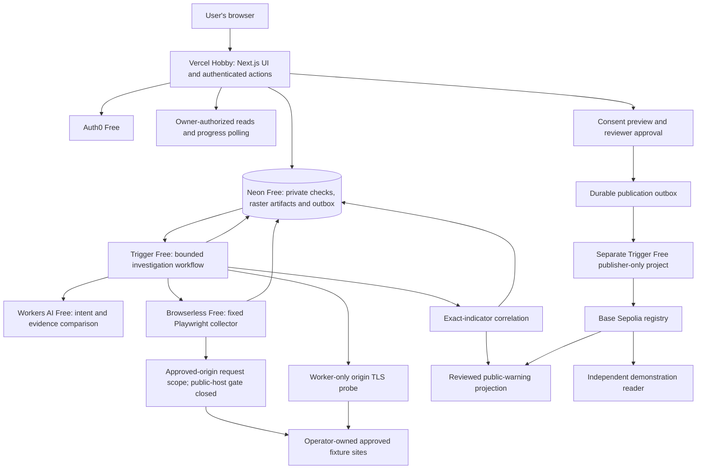

# Scamwin web app: product and architecture design

> **Current design: all-online, ₹0 hackathon prototype.** The active stack is Vercel Hobby, Cloudflare Workers AI Free, Browserless Free, Trigger.dev Free, Neon Free (including compressed private images), Auth0 Free and Base Sepolia with free test ETH. Use the [current implementation/status summary](../../scamwin-current-plan.md) and [zero-spend Vercel amendment](../plans/2026-11-08-scamwin-zero-cost-vercel-amendment.md). No paid fallback, laptop investigation worker or mainnet funds are required. Arbitrary-host collection remains disabled.

Date: 8 November 2026. Status: the core prototype and free-provider adapters are implemented and locally tested; real-service setup/deployment/acceptance remains pending. This design includes requirements that are not all finished. The automatic multi-link picker, elapsed timer, structured security impact/fix UI, cleanup tracker, live operations telemetry, populated official-reference directory and dedicated correction editor remain product work. See the [build ledger](../../scamwin-build-progress.md) for actual verification; a design statement is not proof of live capability.

Companion implementation plan: [2026-11-08-scamwin-web-app.md](../plans/2026-11-08-scamwin-web-app.md).

## 1. Product purpose and source of requirements

Scamwin helps a person decide whether to take a particular action requested by an online offer. Its central question is: **What was I promised, what am I actually being asked to do, and where would my money or information go?** A check accepts a URL, message, screenshot, or a combination, gathers permitted evidence, compares the promise with the requested action, and explains the findings and unknowns.

The challenge description available to us is the user's pasted prior conversation, rather than the original rulebook/PDF. It describes six modules: URL analysis, TLS/certificate trust, AI scam-message analysis, evidence-backed threat correlation, website security assessment, and decentralized threat intelligence. The design addresses all six, but full certificate revocation/CT verification and arbitrary-host browser investigation are explicitly later work. It does not invent scoring weights or claim that this scope guarantees shortlisting.

Primary audience: individuals checking refund, scholarship, recruitment, and similar offers, initially English-speaking users with India-relevant examples. The first demonstration focuses on refund/payment deception. Ordinary visitors do not create bots, choose agents, install an extension, connect wallets, or provide credentials for the suspected site.

## 2. Existing foundation and architectural choice

Source inspected at OpenMods commit `b9231c068c7110be896caeb6dd8a69beb78bbf7b`:

- Next.js 16.4.2, React 19.3.0, TypeScript, Tailwind 4, shadcn/Base UI, React Hook Form and Zod.
- Auth0 accounts, server-side ownership checks, Neon Postgres/Drizzle, Trigger.dev 4.8.1, AI SDK 7.
- Legacy OpenMods only: Daytona SDK 0.230.0, per-bot persistent computers and generic chat tools. These paid-provider paths are not used by the Scamwin workflow and require no Scamwin credentials.
- Image preprocessing and validation, chat streaming/history, operational usage records and sanitized monitoring.
- Optional Playwright/Chromium, Nmap, Nikto and ZAP installer. Installed binaries do not constitute integrated scam detection or a scoped assessment engine.

The original schema stored bots/chats/members/usage rather than the Scamwin domain. The implementation now adds separate checks, observations, artifacts, review and publication tables. The original chat agent exposes broad execution tools; Scamwin uses dedicated bounded adapters and does not repurpose that unrestricted agent as its security boundary.

Approaches considered:

1. **Extend the existing TypeScript application with dedicated domain modules and jobs — selected.** Reuse authentication, UI primitives, data access, image preparation and worker patterns. Add a fixed remote Browserless collector and direct Workers AI adapter; do not inherit the generic computer/chat provider runtime.
2. Separate Next.js frontend plus a new Python/FastAPI service. Valid for a larger team, but duplicates validation/deployment/ownership work for the initial build. Reconsider only for a demonstrated specialist dependency.
3. Rebrand group-chat bots as investigators. Fast visually, but does not provide durable evidence, deterministic policy or trustworthy correlation. Rejected as the main architecture.

## 3. Delivery boundaries

The original 48-hour estimate assumed 3–4 contributors, working service accounts and ready owned demonstration fixtures. The free version uses a remote Browserless session instead of a VM snapshot. Live account/capability setup and the remaining product gaps still need time; a production containment/governance guarantee does not follow from the local build.

| Capability | Hackathon pilot | Complete application |
| --- | --- | --- |
| URL/message/screenshot intake | Yes, private authenticated checks | Same plus stronger extraction and localization |
| Live browser observations | Exact operator-owned public origins only | Public-origin collector after network enforcement and abuse controls pass |
| Unexpected destination | Record and stop; never expand scope automatically | Validate through the enforced egress path within policy |
| URL string and reviewed-warning lookup | Yes for valid public-host URLs; no visit required | Broader licensed threat-source enrichment |
| TLS/security headers | Real bounded origin probes only for approved fixtures | Public-IP-pinned origin probes with enforced outbound limits |
| Certificate detail | Hostname, dates, chain result, issuer/SAN/fingerprint, negotiated TLS | Validated CT/revocation evidence and known-incident references |
| Promise/action analysis | Structured AI plus deterministic evidence | Evaluated expanded scenario support |
| Correlation | Exact indicators in owner's cases and reviewed public warnings | Richer explainable relationships and institutional access policies |
| User-visible browsing | Expandable observations and owner-authorized static screenshots; no live desktop required | Hardened case-bound live observation, no consumer takeover |
| Web3 | Reviewed exact-host warning on Base Sepolia; second reader | Independent publishers/indexers and consumer trust policies |
| Operations | Role-gated configuration readiness and admission/signing pause controls; live job/resource/cleanup telemetry remains unfinished | Full operations UI and incident response tooling |

The browser feature stays disabled if the actual account/SDK cannot enforce the approved network policy. The app remains useful with message/image analysis, local URL checks and warning lookup, clearly marking live website facts as not checked. Never silently replace a live check with a fixture.

## 4. Technology stack

| Layer | Choice and purpose |
| --- | --- |
| Web UI and server | Existing Next.js App Router + React + TypeScript on Node 24; responsive website |
| Styling/forms | Existing Tailwind, shadcn/Base UI, Lucide, React Hook Form, Zod; reuse accessible primitives |
| Accounts | Auth0 Free; owner comes from server session, never request body |
| Database | Neon Free + Drizzle; JSONB for versioned assessments, indexed ownership/private HMAC indicators and separate expiring raster artifact rows |
| Background execution | Trigger.dev Free; dedicated investigation/maintenance project plus separate publisher-only project, each using its own configuration and dispatch key |
| AI | Direct Cloudflare Workers AI Free REST adapter, allowed Scout vision model, bounded prompts and parsed/Zod-validated JSON; no paid model fallback |
| Browser | Browserless Free remote Chromium using pinned Playwright 1.64.1; fresh nonpersistent context, fixed approved-origin observation and explicit closure |
| Technical probes | Worker-only Node `dns`, `net`, `tls`, `crypto` and `ipaddr.js`; public-address-pinned TLS with original SNI/hostname verification |
| Extraction | DOM/text parsing and deterministic `upi:` payment-URI parsing. QR decoding is not implemented; image provenance is retained and model guesses cannot create a confirmed recipient |
| Private artifacts | Small prepared raster bytes stored privately in Neon, at most 160 KiB/image with case/global caps and seven-day expiry; authenticated artifact routes, no separate bucket |
| Web3 | Solidity, OpenZeppelin Contracts, Hardhat 3 with viem/Node tests in isolated `web3/` package; `viem` server client; Base Sepolia 84532 |
| Relationship display | Evidence-linked list first; existing React Flow dependency for later graph view |
| Deployment/monitoring | Vercel Hobby website, two Trigger Free projects, Neon Free, Workers AI Free, Browserless Free and Base Sepolia; sanitized existing logs, no required paid monitoring plan |
| Testing | Existing Node test runner/tsx and Playwright; Hardhat contract tests; a small labeled evaluation set and network-level containment tests |

Pin new packages/compiler to compatible exact versions when implementing; preserve the checked-in lockfile baseline unless a specific compatibility test justifies change. Do not add Redis, a vector database, Neo4j, a new auth provider, a second application language or a separate web backend for the pilot.

No paid scraping API or external threat feed is required. Official identity uses manually curated server-side references with verification time; the lookup mechanism exists but a populated demonstration directory still needs preparation. Search ranking or model-supplied links cannot establish an official identity.

## 5. Architecture and data flow



The web process never launches Chromium or performs a long scan within an HTTP request. It validates the owner/input, creates one case/run/outbox entry atomically, and returns an ID. The worker gathers observations and writes authoritative state. The client polls an owner-authorized endpoint every 2 seconds while active, backs off to 10 seconds when hidden/reconnecting, and stops at a terminal state. Use a revision number to ignore stale responses. No public Trigger write token is needed for this pipeline.

## 6. Screens and feature inventory

| Route | Purpose and actions |
| --- | --- |
| `/` | Explain the product, show a labeled synthetic example, Check an offer, browse reviewed warnings |
| `/sign-in`, `/sign-up` | Existing Auth0 flow; return first-time users to `/check` |
| `/check` | URL, promised benefit/message, intended action, up to four screenshots; inline interpretation/correction; Check offer |
| `/checks` | Private history; server-paginated 20 rows, newest first; status/domain search, reopen, recheck, delete |
| `/checks/[checkId]` | Progress, decision summary, journey, evidence, website trust/configuration, related cases, follow-up, share-for-review |
| `/warnings` | Public reviewed hostname warnings; issuer/status/category filters, provenance, dates, correction/retraction and feed freshness |
| `/warnings/[warningId]` | Exact hostname scope, publisher, local reviewed status and separate current registry read; reviewer retraction. Dedicated correction/dispute editor remains unfinished |
| `/account` | Session/account links, privacy explanation, case deletion controls, sign-out; data export is full-version scope |
| `/review` | Reviewer-only queue of explicitly shared redacted submissions; approve/reject/request information; changed material requires a fresh owner-consented submission |
| `/operations` | Admin-only configuration readiness, limits and new-admission/new-signing pause controls; live job/resource telemetry remains unfinished |

The result is ordered: **decision being considered → important risk observations → promise/action/destination journey → evidence and coverage → technical details → related cases → follow-up**. A mobile user never needs to operate a remote desktop to understand a result. Technical facts include observation time and origin; screenshot text supplied by a user is labeled as user-supplied evidence, not a live-site observation.

Every applicable screen supports empty, pending, success, partial, unavailable and error states. Specific outcomes include invalid/private URL, unreadable image, no correlation match, login/CAPTCHA barrier, blocked redirect, timeout, cancellation, expired session, stale feed, and failed publication. No missing check is painted green.

### Visual and interaction direction

Keep OpenMods' existing Geist/Geist Mono and shared primitives initially. Preserve its charcoal application shell (`#080808` background, `#141414` panels, muted text `#a1a1a1`) while making the distinguishing element an evidence-linked journey with three meaningful stops: promise, requested action and destination. Do not lead with mascots, bot rosters, fake percentages, animated terminal noise, or a decorative graph.

Before implementation, record the observed baseline in project-root `DESIGN.md` and the accepted workflow in `UX-CONTRACT.md`, with `app/globals.css` as the existing runtime token owner. Any new semantic risk/focus colors must pass contrast checks and be introduced in tokens and documentation together. Product interfaces target WCAG 2.2 AA, 320px mobile width and 200% zoom. Use visible labels, semantic buttons/links, keyboard access, non-color status text, meaningful stage announcements, reduced motion, accessible dialogs and stable loading geometry. Avoid sending sensitive queries to URL search parameters; private history search stays in component state and authenticated request bodies.

## 7. Inputs, AI and evidence contracts

Input limits: URL 4,096 characters; combined text 12,000 characters; up to four source images of 10 MiB each; reuse browser conversion to still JPEG at most 160 KiB/image and at most a 2,048px starting longest edge. Original GIF animation is not analyzed. Require at least one URL, nonempty message, or image. Analyze at most one explicitly selected destination per check. The current form has one manual URL field; automatic extraction/selection among multiple message links remains unfinished. Never silently visit inferred links.

Before submission, an inline restatement is derived from the user's form fields, with no AI call or extra wizard. The person edits the promise/intended action directly. The persisted job later extracts the message/image interpretation and displays it with uncertainties. A material correction after dispatch cancels an active run and creates a new check from editable inputs; prior inputs remain immutable. A message-only or screenshot-only check is supported, with website/TLS modules marked not checked. Candidate URLs/recipients inferred by AI are not network targets or confirmed indicators until deterministic validation/user confirmation; choosing a newly extracted destination creates a new check.

Two normal Workers AI calls extract `OfferIntent` and compare bounded observed text against the offer. Deterministic risk rules create the final evidence-linked assessment. Maximum three analysis calls including one shared schema repair, 30 seconds each and 1,500 output tokens/call. Parse and validate every model response; do not assume strict provider schema conformance. Evidence-grounded follow-up is a separate 30-second request, capped at 20/day globally and five/day/account, with no browser/shell/publication tools. Private content is not copied into generic bot memory or Trigger chat transcripts.

Conceptual types (authoritative Zod/TypeScript definitions are created in implementation):

```ts
type CheckState = 'queued' | 'validating' | 'collecting' | 'analyzing'
  | 'completed' | 'partial' | 'blocked' | 'failed' | 'cancel_requested' | 'canceled';
type ObservationStatus = 'observed' | 'blocked' | 'unavailable' | 'not_checked' | 'not_applicable';
type Risk = 'high_risk' | 'needs_caution' | 'no_observed_red_flags' | 'inconclusive';
type OfferIntent = {
  promisedBenefit: string | null; claimedOrganization: string | null;
  intendedAction: string | null; requestedActions: string[];
  extractedCandidates: { kind: string; value: string; sourceRef: string }[];
  uncertainties: string[];
};
type Observation = {
  id: string; checkId: string; runId: string; kind: string;
  status: ObservationStatus; sourceKind: 'user_text' | 'user_image' | 'live_page' | 'origin_probe' | 'official_source' | 'registry';
  observedAt: string; sourceRef: string; artifactId: string | null;
  data: unknown; collectorVersion: string; policyVersion: string;
};
type Assessment = {
  schemaVersion: 1; risk: Risk; summary: string;
  findings: { id: string; statement: string; classification: 'observation' | 'inference'; evidenceIds: string[] }[];
  missingChecks: string[]; nextSteps: string[];
};
```

`Observation.data` is a discriminated validated union in code, never unchecked model JSON. The model proposes narrative findings; application code validates schema, evidence IDs and allowed statement types and computes the policy risk/coverage result. An unvalidated assessment cannot become a final verdict. Structured outputs ensure shape, not factual correctness.

Risk policy v1: flag an observed risky action/intent mismatch or an active trusted publisher warning prominently; distinguish the action risk from a confirmed allegation of fraud. Message urgency, missing headers, a valid/invalid certificate, shared hosting, or an issuer alone never establish fraud. `no_observed_red_flags` requires completed applicable minimum checks, readable content and no supported risk rule; missing important evidence otherwise gives `inconclusive`. Strong observations can still justify a high-risk action warning when other modules are incomplete; coverage remains separate. Store rule/prompt/model versions, not an invented scam probability.

Exact v1 precedence and coverage:

1. `high_risk` if a fresh registry projection contains an active assertion by a configured trusted publisher for the exact hostname; describe it as that publisher's warning. Also `high_risk` for a user-explicit receiving-only intended action paired with an outgoing payment URI parsed by code at the selected observed action checkpoint. The latter is risk of performing that payment action, not confirmation of fraud or identity. A random unrelated donation link is not an action checkpoint. Pilot checkpoints are configured fixture selectors; unconfirmed model choices cannot satisfy this rule.
2. Otherwise `needs_caution` for an evidence-linked semantic promise/action discrepancy, supported impersonation concern, observed request for sensitive information, suspicious URL signal, or failed origin TLS validation. Say when the concern is an interpretation. Mere urgency or an isolated missing optional header is insufficient; configuration findings retain their separate severity.
3. Otherwise `no_observed_red_flags` only when the selected URL is explicit, URL validation succeeds, final destination/redirect collection is complete within scope, meaningful page content and its relevant visible actions were observed, origin HTTPS validation succeeds, reviewed-warning lookup is fresh and has no trusted active match, and any claimed organizational identity has a checked official-reference result without contradiction. No important pending/unavailable check can satisfy this outcome.
4. Otherwise `inconclusive`. Message/image-only, CAPTCHA/login barriers and unavailable mandatory sources normally land here unless a supported higher-priority concern exists. A failed worker with no useful observations produces a failed check without an assessment.

Assessment findings are explanatory, not automatic additions to the rule engine. Add new risk rules only with explicit evidence input contracts, counterexamples and a rule-version change.

## 8. Collector, transport and limits

Pilot browser policy: exact operator-configured public HTTPS origins/assets, with no wildcard discovered from page text. Require the explicit Browserless capability gate before connecting. Create a fresh nonpersistent remote context with no user cookies/profile/wallet/files. Keep the fixed Playwright collector in the worker; never execute model-produced commands or pass service secrets into page content. Close the remote browser on completion/cancellation and use the provider session timeout as a backstop. No laptop or disposable paid VM is required.

Hard limits: one selected URL; two documents; three redirects; at most one approved anchor navigation on a fixture; 100 requests; 15 MiB received data; 60 seconds of browser collection; three captured screenshots; 100 KiB extracted page text. One job has a 240-second active deadline and a 300-second worker lifetime including cleanup. Pilot queue concurrency is 2 globally and one active run per owner. New attempts do not extend the original job deadline.

Install context-wide request policy before creating a page. Permit HTTP(S) GET/HEAD within approved scope; deny other methods and protocols, service workers, WebSockets, downloads, file URLs, permissions, unexpected popups and sensitive submissions. Never fill forms, submit credentials/OTP, pay, connect/sign a wallet, bypass CAPTCHA, enumerate endpoints or run active scanners. Even a GET link can have side effects; the UI promises bounded observation, not universally harmless clicking. In public-host mode use initial render/automatic redirect observation only; scripted CTA steps remain owned-lab functionality.

Actual egress enforcement is a later release gate. Browserless Free availability does not prove a malicious-site sandbox or network isolation. Public-host rollout requires an approved controlled egress path that validates every destination/subresource, rejects non-global/mixed DNS, pins dialed IPs with original host/SNI, denies direct IPv4/IPv6/UDP/QUIC/WebRTC/control-plane/metadata escape and revalidates connections. Proxy variables and Playwright routes alone are insufficient. Keep arbitrary-host collection disabled unless a separately reviewed collector and deployment/budget decision establish those controls; never silently add paid infrastructure.

Origin certificate/HTTP probes are separate bounded worker operations through a public-IP-pinned transport, outside the browser's TLS interception. Resolve once per connection, reject non-global answers, connect to that validated address with original host/SNI, allow only ports 80/443, use manual bounded redirects and preserve response/header limits. Pilot probes only approved fixtures. Certificate facts include hostname match, validity dates, chain-verification result, issuer/SAN/fingerprint and negotiated TLS version. A diagnostic certificate-only connection, if necessary for expired-cert facts, is separately labeled and never renders the page or treats validation as successful. Do not claim OCSP/revocation or CT inclusion verification in v1.

A browser-intercepting certificate must never be presented as the origin certificate. Origin TLS is a separate worker probe, and Browserless observations do not substitute for it. Nmap/Nikto/ZAP and generic legacy chat/computer tools are not invoked in the consumer pipeline.

## 9. Durable lifecycle and data model

Lifecycle: `queued → validating → collecting → analyzing → completed/partial/blocked/failed`; any active state can become `cancel_requested → canceled`. Cleanup state is independent: `not_created/pending/deleted/failed`. One failed optional module yields a partial assessment, not a fabricated observation. A policy block with no useful evidence is blocked; useful remaining evidence can produce partial coverage.

Atomically insert check, run, prepared input artifacts and dispatch-outbox rows using Neon transactions. Unique owner/submission key plus an immutable payload hash prevents duplicates and conflicting key reuse. Persist generation/lease/revision fences so canceled or superseded attempts cannot overwrite a result. The current free prototype makes a failed dispatch explicitly terminal with quota/unavailability guidance; recovery starts a new check after service recovery. Never replay an uncertain remote browser session or silently switch providers.

Cancellation writes the request first. An unclaimed queued check can cancel atomically; a claimed run remains cancel-requested until worker/model/probe/browser cleanup acknowledges it. The UI cannot undo a request already sent. Explicit session closure/provider timeout replaces VM deletion. Owner/internal reads and admission fence overdue runs after 300 seconds; daily online maintenance handles private data expiry and outbox recovery. Existing legacy bot resources are never touched. User-visible cleanup tracking remains unfinished.

Proposed tables in a separate `lib/db/scamwin-schema.ts`, re-exported through the configured schema entry:

| Table | Essential fields / indexes |
| --- | --- |
| `scamwin_checks` | id, ownerId, input text/selected URL, intent JSON, state, generation, policyVersion, createdAt/expiresAt/deletedAt; unique owner/submissionKey; owner/time index |
| `scamwin_runs` | id, checkId, generation, state, deadline, heartbeat, cleanupState, owner and retained admission time; unique check/generation |
| `scamwin_artifacts` | id, checkId/runId/owner, validated prepared raster bytes, type/bytes/hash, source/time and expiresAt; separate private Neon rows, no public URL |
| `scamwin_observations` | immutable typed evidence contract, check/run IDs; check/kind/time index |
| `scamwin_assessments` | check/run IDs, validated findings JSON, risk/coverage, model/prompt/rule versions; one accepted result per run |
| `scamwin_indicators` | check/owner IDs, kind and owner-scoped HMAC fingerprint; owner/kind/fingerprint index; no raw indicator value retained |
| `scamwin_messages` | check/owner IDs, follow-up role/text, cited observation IDs, timestamp; check/time index |
| `scamwin_warning_submissions` | owner, explicit redacted public draft and independent selected evidence snapshot, consent time/payload hash/draft revision, packet expiry, reviewer decision/reason/version |
| `scamwin_public_warnings` | exact public hostname, sanitized category/summary, issuer, expiry, review revision, correction/dispute status |
| `scamwin_publications` | warning/review revision, unique operation ID, chain/contract/nonce/tx/block, queued/submitted/included/safe/finalized/failed state |
| `scamwin_job_outbox` | action kind, aggregate ID/generation, idempotency key, attempt/lease/dispatch state; unique idempotency key |
| `scamwin_roles` | Auth0 subject, reviewer/admin role; unique subject/role; server assigned only |
| `scamwin_audit_events` | action/actor class/object ID/time, sanitized code; no raw offers/URLs/screenshots/secrets |
| `scamwin_registry_sync` | versioned operational state (including admission/signing pauses); any future chain checkpoint must retain verified block/hash/freshness rather than pretending continuous polling exists |

Private case correlations are computed from indexed indicators on read; no graph database is required. Owner-scoped matches cannot expose another person's case, existence, screenshot or message. Public matches come only from separately reviewed public records. Similar IPs/CDNs/issuers are contextual associations, not a campaign verdict. Preserve sources when exact recipients/endpoints match; do not infer common ownership from a match alone.

Follow repository rules: development-only schema changes through `npm run db:push`, no migrations/backfills, no automatic branch/worktree/commit. Do not apply this disposable-data policy to valuable production data. Production schema lifecycle is a separate launch decision before that environment holds valuable user data.

## 10. Security, roles, privacy and publication consent

Standard users access only their checks/artifacts/messages. Reviewers see only expressly submitted redacted review packets. Admins configure roles, operational limits and publishers; admin status does not automatically grant access to all private messages. Enforce permissions on every server action, read, artifact stream and job dispatch; use same-origin checks on mutations and owner-filtered database queries. Never trust a submitted ownerId, role or evidence ID without authorization.

Pilot application limits are safeguards, not provider entitlements: one active check/account, 10 new checks/day globally, 50/month globally, three/day/account, three review submissions/day/account and browser concurrency two. Follow-ups have separate 20/day global and five/day/account caps. Atomic reservations use server UTC timestamps and survive deletion. Free-provider refusal overrides estimates; there is no paid fallback, recharge or upgrade path.

Private artifacts/inputs and follow-up remain private by default. Before sharing, show the exact public hostname, category and sanitized summary, plus any evidence selected for reviewers. Explicit submission consent and reviewer approval are separate requirements. The model never publishes. Public chain content is permanent history; retraction changes status, not erasure.

Consent binds to the canonical public draft payload hash, schema version and draft revision, including hostname, category, summary and proposed expiry. A materially changed public draft requires the owner to preview and consent again; reviewer approval cannot silently change what was authorized. New expiry/renewal is a new draft/review. A reviewer may reject or request changes without publishing.

Selected redacted evidence is copied into an independent private review packet with reviewer-only access and a seven-day expiry from submission. The original artifact is not made globally readable. Deleting/expiring the original check withdraws pending review, revokes any publication not yet leased for signing, and schedules removal of the review snapshot. The relay obtains a database publication lease against the current consent revision before signing; deletion after that boundary is labeled publication in progress and cannot promise that a transaction will not appear. Reconcile any broadcast, and offer a separately reviewed correction/retraction. A published public warning is independent of private-check deletion; sanitized public revision history/chain metadata remains, while private review evidence still expires at seven days. This lifecycle is shown before sharing and tested at the deletion/publication race boundary.

App retention targets: private raster artifacts and reviewer evidence snapshots seven days, private checks/observations/follow-up 30 days and content-free operational audit 90 days. These do not promise provider-backup/API retention or legal compliance. Expiry-filtered reads hide unavailable data before daily Neon cleanup; cancellation closes the remote session. Public warning history and permanent chain events remain separate. Avoid Trigger `defaultStorage` and generic bot memory for case content. Task payloads/logs use IDs and sanitized codes; providers still process submitted content and the UI must explain that.

## 11. Web3 design

Pilot network: Base Sepolia (chain ID 84532), visibly labeled test network and using free test ETH only. Normal users use Auth0 without a wallet. A dedicated publisher-only Trigger Free project signs approved exact-host warnings. Its signing key is absent from Vercel, the investigation project, the model and remote page context; web dispatch uses that project's distinct API credential. No owner/guardian key is placed in ordinary workers.

Deploy a non-upgradeable `ThreatRegistryV1` with no token, staking, voting, user payment, wallet connection or arbitrary external calls. Use OpenZeppelin two-step ownership plus publisher/guardian permissions. Start with one operator's reviewer/publisher; call this a **permissioned publicly readable warning registry**, not a fully decentralized review network. Two independent readers and later independent organizational publishers establish the path beyond the hosted application.

Normalization v1: lowercase IDNA ASCII hostname, remove a terminal DNS dot, retain subdomains and `www`, reject credentials/path/query/fragment/ports as registry hostname input. Do not publish private hosts, full submitted URLs, personal recipients, screenshots, messages, user IDs, private case IDs or hashes of private evidence. Path-specific abuse on shared hosting must not become an unqualified warning about the entire host. Publish only domain-wide claims with adequate scope; otherwise keep the finding private.

Indicator ID: `keccak256(abi.encode(uint16(1), uint8(1), hostname))`. Publish normalization test vectors so an independent client gets the same ID. The identifier is not a privacy mechanism.

Store independent assertions per publisher/activation epoch/indicator. Fields: revision (`uint32`), issuedAt/expiresAt (`uint64`), category (`uint8`), retracted flag. An activation epoch changes on publisher re-enablement so old assertions cannot revive. Contract publication uses expected revision and a unique random `bytes32 operationId`; repeated operations are rejected. TTL: 1 hour–30 days; app default 7 days. Renewal requires a fresh review. Expiry is derived from chain time, requiring no expiry transaction.

Methods: `publish(hostname, category, ttlSeconds, expectedRevision, operationId)`; `retract(publisher, indicatorId, expectedRevision, reasonCode, operationId)`; owner `setPublisher`; guardian/owner `suspendPublisher` and `pauseIssuance`; owner `resumeIssuance`; public assertion/config reads. Issuance pause must not block reads, retractions or suspension. Emit versioned `PublisherConfigured`, `AssertionPublished` and `AssertionRetracted` events with issuer, epoch, indicator, revision, timestamps, bounded reason/category and operation ID. No raw private content is an argument.

The relay serializes signing leases, simulates calls, validates chain/contract/publisher, reserves capped testnet fees, and persists signed bytes/hash/nonce before broadcast. Uncertain broadcasts reuse the same bytes and reconcile before any new nonce. Track included/safe/finalized separately; a receipt is not finality. The free prototype uses direct on-demand registry reads and daily pending-publication reconciliation instead of continuous polling. Each read is block-pinned and hash-rechecked, with current publisher epoch/status, expiry and retraction; observations older than 60 seconds are stale. Local approved warnings are not current chain proof. Any future event indexer must add duplicate suppression and reorg replay before deployment. One publisher's assertion is not global truth, and investigations continue when sharing is unavailable.

Live demo acceptance still pending: publish a reviewed controlled-fixture hostname on Base Sepolia, read it independently without the Scamwin API, retract it and observe inactive status in both readers. Local Hardhat tests are development evidence only and do not satisfy the user's all-online live demo. If testnet/provider access fails, show unavailable or an explicitly recorded/read-only sample; do not present it as a live chain result or require a laptop worker.

## 12. Application API and operation boundaries

Use authenticated server actions for mutations, matching the existing project. Reads/progress/artifact delivery use owner-checked Route Handlers. Long work happens in jobs. All return objects use validated schemas and sanitized error codes.

Mutations: `createCheck`, `cancelCheck`, `recheck`, `deleteCheck`, `sendFollowup`, `submitWarningForReview`, `reviewWarning`, `retractWarning`, `setOperationalPause`. Every external side effect has an idempotency key and role/payload validation. A recheck creates a new check referencing its predecessor, preserving prior observations.

Reads: `/api/scamwin/checks/[checkId]`, `/api/scamwin/checks/[checkId]/observations`, `/api/scamwin/artifacts/[artifactId]`, `/api/scamwin/warnings`, `/api/scamwin/warnings/lookup?hostname=...`, `/api/scamwin/registry/status`. Public lookup accepts hostname only; private messages/full URLs never enter public query strings. Responses expose coverage, version and source freshness. Missing or foreign private IDs return the same not-found behavior.

## 13. Evaluation, delivery gates and later capabilities

Prepare owned fixtures: deceptive refund/payment page with valid HTTPS; legitimate comparison flow; different offer sharing a collection indicator; harmless shared-CDN counterexample; login/CAPTCHA barrier; redirect to denied origin; prompt injection; TLS failure; image-only evidence; unavailable page. Prove actual outputs from fixtures instead of hard-coded risk scores.

Measure promise/action extraction accuracy, correct exact-indicator matches, evidence-reference validity, false high-risk results, incomplete-check behavior, latency, provider usage and cleanup. Do not claim real-world accuracy from a tiny fixture set. Public-host launch requires independent network containment/tenant isolation/cancellation tests and a larger labeled evaluation corpus.

Later features: broader official-source directory, validated CT/revocation/incident integrations, QR reliability improvements, approved external threat feeds, independent institutional publishers, graph exploration, user-selected monitored checks, Hindi/other languages, export, institution workspaces and optional browser extension. These are explicitly separate from the pilot. Wallet transaction simulation, autonomous VAPT, exploitation, payments, takedowns and automatic public accusations are outside this plan's initial scope.

## 14. Primary technical references checked during planning

- [Workers AI REST API](https://developers.cloudflare.com/workers-ai/get-started/rest-api/), [Scout vision model](https://developers.cloudflare.com/workers-ai/models/llama-4-scout-17b-16e-instruct/), [pricing/free allowance](https://developers.cloudflare.com/workers-ai/platform/pricing/): validate account/model/image access and parse every JSON response while testing grounding independently.
- [Playwright network](https://playwright.dev/docs/network), [BrowserContext](https://playwright.dev/docs/api/class-browsercontext): context-wide request controls and service-worker limitations.
- [Browserless connection](https://docs.browserless.io/baas/quick-start), [unit consumption](https://docs.browserless.io/overview/unit-consumption): verify Free account/session capability, closure and quota refusal; free availability does not prove arbitrary-malware isolation.
- [OWASP SSRF guidance](https://cheatsheetseries.owasp.org/cheatsheets/Server_Side_Request_Forgery_Prevention_Cheat_Sheet.html), [Node 24 TLS](https://nodejs.org/download/release/v24.20.0/docs/api/tls.html): public-IP-pinned transport with correct host/SNI.
- [Trigger tasks](https://trigger.dev/docs/tasks/overview), [idempotency](https://trigger.dev/docs/idempotency), [cancellation cleanup](https://trigger.dev/changelog/oncancel): durable dispatch is distinct from idempotent external effects.
- [Neon Free](https://neon.com/pricing), [Auth0 Free](https://auth0.com/pricing), [Vercel Hobby](https://vercel.com/docs/plans/hobby), [Trigger Free](https://trigger.dev/pricing): verify active free-plan eligibility and limits before live acceptance; no purchased domain, paid AI/browser fallback or object-storage account is required.
- [Hardhat setup](https://hardhat.org/docs/getting-started), [Node support](https://hardhat.org/docs/reference/nodejs-support), [Base connection details](https://docs.base.org/get-started/connect-to-base), [Base finality](https://docs.base.org/specifications/transactions/transaction-finality), [OpenZeppelin access control](https://docs.openzeppelin.com/contracts/5.x/access-control), [viem simulation](https://viem.sh/docs/contract/simulateContract): testnet registry and publisher isolation.

## 15. First-time user journey

1. The visitor opens the website and sees “Check an offer before you act,” a clearly labeled sample and the Check an offer button. The introduction explains that checks can be incomplete and that the app cannot certify every offer as genuine.
2. They choose Check an offer and sign in through Auth0. Custom submission begins after sign-in, so the first authentication redirect cannot lose an entered screenshot/message. No wallet, bot or avatar setup appears.
3. They paste the message, manually select one destination in the URL field, describe the promise/intended action and optionally add screenshots. Automatic multi-link extraction/selection remains unfinished. Limits and private-by-default handling are shown.
4. Scamwin restates the entered promise/action inline without an extra AI call. They correct the form if necessary and press Check offer once. Server confirmation creates the saved check before the progress page opens; extracted AI interpretation appears during the saved job.
5. The progress page shows saved stages and Cancel, and later captured observations when available. An elapsed-time counter remains unfinished. They can leave and reopen the job from My checks. Unsupported live destinations are labeled and never trigger unrestricted browsing.
6. The result explains the action risk first. In the refund example, it points to the outgoing-payment request, visible recipient and any independently checked official-reference contradiction. Every material claim opens its evidence and observed time.
7. They can inspect the journey, certificate and configuration details, missing checks, and related private cases/reviewed warnings. No match does not mean safe; unreadable or blocked content remains an explicit limitation.
8. They ask a follow-up such as “What should I verify before paying?” The answer uses this check's evidence and approved official sources. It does not silently launch more browsing, sign a transaction or perform a scan.
9. Their check stays in My checks for the displayed retention period. Recheck creates a fresh saved check and deletion hides the private check; user-visible cleanup tracking remains unfinished. A session expiry preserves the open draft in memory and offers reauthentication in a separate tab before retrying.
10. Sharing is optional. Submit for review shows the exact redacted public warning and evidence selected for a reviewer. After explicit consent, the item is pending, not public.
11. A reviewer approves or rejects with a reason. A published warning shows its publisher, scope, expiry, corrections and genuine chain status. Another client can use the shared warning, while private messages/screenshots remain outside the public registry.
