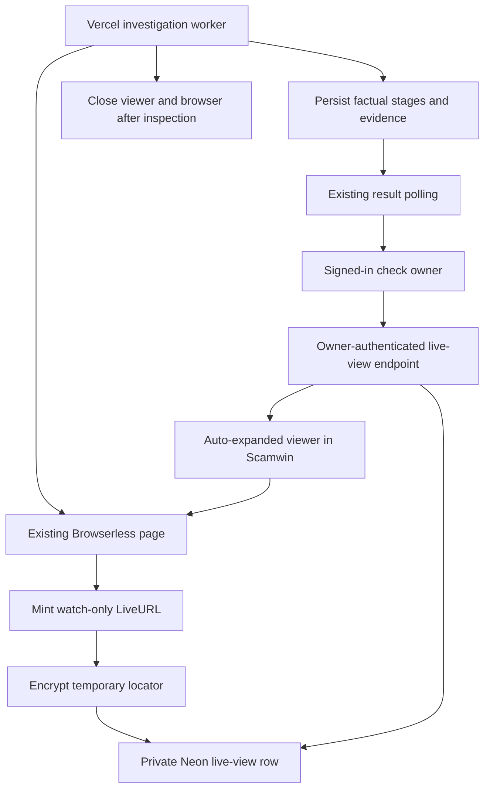

# Scamwin live investigation UI design

Date: 9 November 2026. Status: selected product direction recorded for implementation planning; application implementation has not started.

## Confirmed scope

The user selected a genuine, continuously updating, watch-only Browserless view that opens automatically inside the check page during website inspection. They also selected truthful detailed progress, a stronger promise/intention/observed-request comparison, and clearer results with inline evidence. This is a focused change to Scamwin's investigation experience.

The existing Vercel investigation worker, Cloudflare analysis, Neon storage, Auth0 ownership, approved-origin collection policy and separate Vercel publisher continue to supply the underlying workflow. Trigger.dev is not required for this feature.

## Approaches and selection

1. **Captured preview:** display existing JPEG evidence. Lower integration cost, but it is a still image. The user explicitly chose actual live viewing instead.
2. **Selected: real Browserless LiveURL:** embed a temporary view of the exact page already being inspected. Browserless streams the canvas; the app does not embed the target website directly. This requires private session delivery, lifecycle handling and real progress updates.

Saved screenshots are the post-inspection and failure fallback. They are always labelled as captures and never presented as a live implementation.

## Experience

- Keep the charcoal, Geist, soft blue and pink identity in DESIGN.md and app/scamwin.css. This is a product screen with restrained motion, not a terminal, fabricated agent conversation or score game.
- During collection, show a wide browser panel beside the stage timeline on desktop. On narrow screens, keep the auto-expanded browser panel first and place the timeline below it. Use document scrolling, not an automatically opened popup, tab or modal.
- Show a descriptive title, validated hostname, Browserless attribution, server-dated elapsed time, watch-only status and Cancel check. Auto-expansion must not steal keyboard focus or scroll position. A user can collapse/reopen the panel; polling does not override that choice for the same run.
- Preserve the existing remote viewport of 1200 by 800. Letterbox/scale the frame responsively; do not resize the remote page when the local layout changes.
- Viewer states: preparing, connecting, live, interrupted, unavailable and ended. An iframe load event alone is not proof of a connected stream. Use documented backend Browserless events; the iframe handles its own reconnect display.
- The live view exists only during collection. After collection closes, show the actual capture and observed time while remaining verification/analysis continues. If a fast inspection ends before the viewer connects, say so and show the capture. Do not pad inspection or keep a browser running for visual effect.
- Keep timeline history visible after completion, including blocked or unavailable stages. No invented completion percentage or replay disguised as live.

### Factual stages

| ID | User label | Source of progress |
| --- | --- | --- |
| intake | Understanding your offer | Submitted-input validation and AI extraction |
| browser | Observing the website | Real connect, navigate, read and capture callbacks |
| trust | Checking the connection | Origin DNS/TLS probe |
| registry | Checking shared warnings | Exact-hostname registry lookup |
| comparison | Comparing promise and request | Curated identity check, AI page comparison and private correlation |
| assessment | Preparing your result | Evidence-rule assessment validation and persistence |

Retain the existing overall check states. Stage status supports pending, running, completed, unavailable, blocked, skipped and canceled. Extend stage data with actual started/finished timestamps and a bounded browser detail code. Unavailable work is not completed work; unstarted work in a terminal check is skipped rather than indefinitely waiting. The timer uses server start/end timestamps; a queue timer is explicitly labelled Since submission.

### Decision comparison and result

- Display **The promise**, **Your intended action** and **Observed request**, with observed destination as supporting information.
- The user's selected intention is authoritative for the intention column. A model-inferred request cannot replace it. Prefer the user's stated promise; label an extracted promise when it is used.
- Derive the observed request from saved observations and cite them. A selected outgoing UPI request can show amount/recipient; sensitive-field and form observations describe only what was observed. A form's existence is not an executed submission.
- Keep observation/inference labels. AI comparisons link both their interpretation and the underlying page evidence. Unknown requests/destinations stay unknown.
- Put the verdict, comparison and strongest cited findings first. Present captured images inline with accessible enlargement; keep full record JSON/provenance expandable and evidence deep links working.
- Keep missing coverage near the verdict. Keep evidence-only follow-up questions, owner history, recheck, cancel and delete behavior.
- Shared-warning lookup is a checking stage. Public sharing remains a separate optional action after assessment, with the existing preview, consent, reviewer decision and separate chain publication status. Viewing an investigation never publishes a warning.

## Architecture and privacy

The worker mints the LiveURL through the existing inspected page's CDP connection before navigation. It keeps the connection alive only until collection ends. It persists an encrypted, short-lived locator in a separate owner/run/generation-scoped Neon table. A dedicated authenticated endpoint releases the temporary viewer URL to the current owner. The browser receives the viewer capability, never the Browserless API token or CDP endpoint.

- Mint with interactable:false, resizable:false, mode:tab, showBrowserInterface:false, JPEG quality 50 and captureScale:1. Keep instructions absent. Explicitly bind the existing page target.
- Use the existing 60-second browser budget; LiveURL validity cannot extend that budget. Keep the existing 240-second pipeline and 300-second run/invocation bounds.
- The app frame uses only the documented script/same-origin sandbox permissions. Do not grant clipboard, forms, popup, camera, microphone or location access. Browserless enforces watch-only input rejection on its server.
- Permit only the configured approved Browserless regional origin under frame-src. Do not broaden frame access to arbitrary destinations. No parent postMessage protocol is assumed: Browserless documents that viewer completion is relayed from backend events.
- Keep the locator out of CheckRecord, observations, artifacts, AI prompts, history payloads, public warnings, URLs in logs, analytics and error reporting. It is not a stored recording.
- A LiveURL is a bearer capability: someone who copies it can view until it closes/expires. Owner authentication protects issuance; short validity and provider closure bound access after issuance. Do not describe the provider URL as permanently bound to Auth0.
- Cancellation/deletion must immediately deny further app reads and cause the existing worker cancellation path to close the browser. Crash/timeout protection also relies on the bounded provider deadline. No global in-memory map is sufficient across Vercel instances.
- Persist a session ID with run ID and generation. Late callbacks and an old finally block cannot end a newer session or regress state. Serialize progress writes around the store's revision checks.

## Settings and user preparation

Reuse existing BROWSERLESS_TOKEN, BROWSERLESS_BASE_URL, Cloudflare credentials, Auth0 settings, DATABASE_URL, approved-origin settings and Vercel worker selection. No new provider account/API key, Trigger deployment, WebSocket hosting account or publisher change is planned.

New proposed app settings for main Scamwin Vercel Production and local development:

| Setting | Kind | Meaning |
| --- | --- | --- |
| SCAMWIN_LIVE_VIEW_ENABLED | Config, true after verification | Enables live viewing; false disables this addition without changing the investigation provider |
| SCAMWIN_LIVE_VIEW_ENCRYPTION_KEY | Secret, 64 hexadecimal characters | One generated 32-byte AES-GCM encryption key for temporary locators |

The implementer generates the encryption secret during authorized implementation. The user adds it once to the main project; it is not a Browserless API key and is not needed by the publisher. No secrets should be pasted into a public document or chat screenshot. A later deliberate move to another worker host would require that same app secret on that host.

Browserless documentation explicitly lists authenticated Cloud Free access for the LiveURL REST capability. The current account's actual capability and remaining allowance still require a bounded verification during implementation. Reuse the one existing inspection session, close promptly and do not add automatic paid upgrades or keep-alive waits. If support is unavailable, preserve the existing investigation and report the live-view issue accurately; do not claim a captured image satisfies the selected real-stream acceptance test.

## Acceptance

- An authenticated owner sees an actual streamed page automatically during a real approved-origin inspection.
- Input attempted through the viewer cannot change the controlled page. The worker still uses the same page and collection policy.
- Every timeline update corresponds to actual execution; timer/reload, failure, cancellation and missing-provider states remain truthful.
- The frame remains stable across polling and responsive layout changes. Old check/run responses never attach the wrong viewer.
- Completion replaces the stream with an accurately labelled private capture. A missing/expired capture has a readable fallback.
- A second account cannot obtain the locator. Cancellation, deletion, expiry, stale-generation events and abandoned workers are covered by meaningful tests.
- Current assessment, evidence citations, follow-ups, consent/review and public-warning behavior still work.
- No app code or credentials are changed by this planning document.

## Sources checked on 9 November 2026

- [Browserless embedding and view-only requirements](https://docs.browserless.io/baas/monitor-sessions/embedding-live-url)
- [Browserless CDP LiveURL options and events](https://docs.browserless.io/api-reference/cdp-extensions)
- [Authenticated Cloud Free LiveURL capability](https://docs.browserless.io/open-api/browser-live-post-2)
- [LiveURL management and capability privacy](https://docs.browserless.io/baas/monitor-sessions/manage-live-url-over-rest)
- Existing source: lib/scamwin/collector.ts, pipeline.ts, contracts.ts, store.ts; components/scamwin/result.tsx; DESIGN.md and UX-CONTRACT.md.
