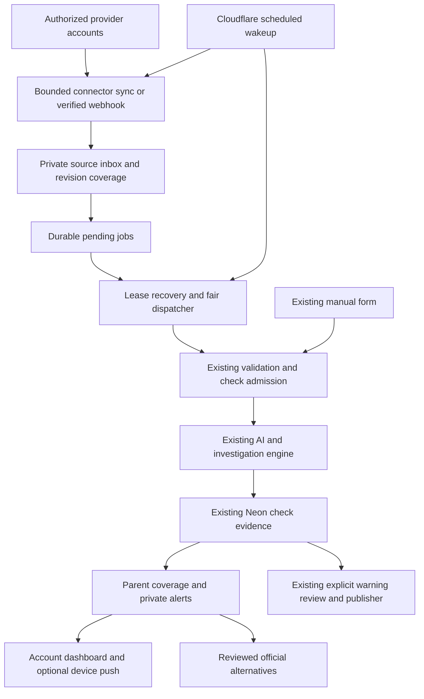

# Scamwin connected apps, private alerts and complete item coverage

Status: proposed design for review; planning only. No application, database, provider account or deployment changes are authorized by this document.

## 1. Product decision and scope

The latest user instruction supersedes the earlier suggestion to require selective AI escalation. A user can choose Manual, Selective automatic, or All new items for each supported connection. All new items sends every retrievable new item inside the explicitly authorized monitoring scope through the investigation queue, including text-only messages and apparently routine messages. A sender, company, bot identity or inexpensive classifier must not silently exclude an item in this mode.

The goal is to help users assess requests before paying, signing in, sharing information, downloading files or following an offer, and to provide reviewed official routes for the same purpose. Existing manual checks remain available. Email forwarding is excluded. Resume analysis, personal job matching, automatic applications, message replies, mailbox deletion, trading and automatic public accusations are excluded.

“All” describes item selection, not unlimited capacity or universal access. It does not grant access to other accounts, historical mail, every Telegram conversation, encrypted/private resources a provider does not expose, or every website through Browserless. Unsupported or missed targets remain visible coverage gaps. Connecting an account never certifies its senders.

## 2. Delivery waves and actual source access

| Wave | Connection | Authorized coverage | Connection/release requirements |
| --- | --- | --- | --- |
| 1 | Gmail | New messages in the connected mailbox or selected labels; user-selected current messages in Manual mode | Separate Google OAuth, gmail.readonly, project/consent/callback setup. Start with a personal/test-user pilot. Public server processing of restricted data is a separate verification/security-assessment gate. |
| 1 | Outlook / Microsoft 365 Mail | New messages in the user's mailbox or selected folders | Delegated Microsoft Graph Mail.Read with refresh authorization; personal and work/school account support configured explicitly. Tenant policy may require approval. No Mail.Send or Mail.ReadWrite. |
| 1 | Telegram Chat Automation | New and edited messages in private chats the user authorizes for the account-connected bot | Current Secretary/Chat Automation connection, BotFather bot token, verified webhook, account ownership link. Current Telegram docs permit this without Premium and allow one connected bot per account. Groups/channels require separate installations. No personal session credentials or OTP collection. |
| 2 | Slack | New events in installed, authorized conversations selected for monitoring | OAuth installation, signing secret, scopes matching selected channel resources, recovery respecting rate limits. A bot installation does not expose the user's whole DM inbox. |
| 2 | Teams | Authorized work/school chats, installed teams or resource-specific scopes | Microsoft Graph or RSC installation and appropriate owner/admin consent; ordinary mention-only bots are not whole-chat monitoring. |
| 2 | Discord | Manual message actions; selected server-channel automatic coverage only after a persistent Gateway runtime is qualified | Bot installation, interaction verification key, channel permissions and applicable message-content approval. No personal Discord inbox promise. Manual-only capability remains explicit until automatic runtime acceptance passes. |
| 2 | Google Drive | Selected, authorized files and their retrievable revisions | drive.file selected-file scope first. Whole-Drive reading is a separate restricted-scope/public-release decision; a selected folder does not automatically authorize every file. Supported-format coverage is explicit. |
| 3 | Chrome / Edge extension | User-invoked current pages; optionally visible pages on explicitly permitted sites | activeTab for manual use; separate host permission for automatic visible-page use. It works when the browser is available. Unpacked/Edge pilot avoids promising a free Chrome Store release. |

Wave numbers are delivery order, not a claim that these integrations already exist. No card may display Connect or All new items until its implemented capability and configured credentials pass readiness checks. Unsupported capabilities display Planned, Manual only, Requires approval or Unavailable accurately.

### Approaches considered

1. Full model work on every item without a durable inbox: matches selection intent but loses interrupted work and exhausts prototype budgets. Rejected.
2. Mandatory suspicion filtering before AI: efficient but contradicts the latest All new items requirement. Retained only as the separately selected Selective mode.
3. Direct authorized connectors, a durable private source inbox, explicit coverage and fair quota-aware processing into the existing engine: selected planning approach. It preserves manual use and makes pending/unsupported work visible.

This document fixes product behavior and the proposed implementation approach. Provider production releases and billing remain gated by verified requirements; no paid fallback is introduced.

## 3. Account and navigation experience

Preserve New check (/check), My checks (/checks), Shared warnings (/warnings), Account (/account) and existing check detail URLs. Extend components/scamwin/core.tsx, the actual Scamwin Shell, rather than the legacy OpenMods sidebar.

The signed-in Ayush/account control opens an accessible menu with Overview, Connected apps, Private alerts, Activity & history, Privacy, and Sign out. Add a private notification bell beside it. A Connected apps navigation link points to the same canonical account route.

Account route navigation:

| Route | Page behavior |
| --- | --- |
| /account | Personal overview: account identity, monitoring summary, pending coverage, unread alerts and existing service status |
| /account/connections | Provider cards, consent summary, granted scope, mode, last successful sync, capacity, pause/reconnect/disconnect |
| /account/alerts | One private alert dataset used by both the bell and this page; read/unread, source/check links and recovery notices |
| /account/activity | Owner-only ledger for imported items/revisions, queued/checking/partial outcomes, connection changes and manual-check references |
| /account/privacy | Existing retention/privacy information, connection data handling, notification permissions and explicit deletion controls |
| /checks | Existing canonical private check history and its current actions; reuse rather than replace it |

Activity & history references check IDs and reuses the existing History component/list actions for saved investigations. It does not create a competing check dataset. Private alerts never become Shared warnings automatically. Public submission, consent, reviewer approval and the isolated publisher remain unchanged.

Use the existing charcoal surfaces, Geist, evidence-blue controls and app/scamwin.css tokens. Route tabs are links with aria-current, not inert tab-looking buttons. Lists use server pagination at 20, newest first, with loading/empty/no-results/error/retry states. Private search remains in component memory and authenticated request bodies, never URLs, analytics or browser storage. Retain document scrolling, 320px access, keyboard focus and reduced motion. Parameterize the shared Confirm labels before disconnect/revoke use; the existing Keep check/Deleting labels are inappropriate. Give SearchBox a unique ID before rendering multiple instances.

## 4. Modes, scope and consent

Each connection starts in Manual until the owner explicitly saves an automatic mode and confirms its scope. Modes:

- Manual: no background content import or automatic investigations; the user selects an accessible item to check.
- Selective automatic: new items matching explicit saved criteria enter the full queue. Nonmatches are labelled Not selected by your rules, never verified safe.
- All new items: every retrievable new item in the chosen scope enters the full queue. Rules and familiar-sender lists do not silently skip it.

Record activation time, provider cursor, scope version and a monotonically increasing connection epoch. Historical import is off by default. A separately requested, date-bounded catch-up uses the same budgets and coverage ledger. Reconnect shows whether missed items within retention will be resumed; it never silently imports pre-activation history.

Before grant, explain the account/scope, supported formats, selected mode, external AI/website processing, retention, timing and disconnect behavior. Authentication remains Auth0; mailbox permission is separate. Derive ownership from the authenticated subject and saved provider grant, never a subject in a browser or webhook payload. One provider account cannot silently change owners on reconnect; require verified ownership transfer or rejection.

Pause stops new provider fetching and new connector admissions; already admitted checks may finish and queued items remain paused. Manual-mode or paused Telegram webhooks must discard message bodies rather than silently import them; record a bounded content-free coverage-gap marker if such items cannot later be fetched. Resume begins with that disclosed gap or a provider-supported reconciliation, never a claim that paused messages were fully inspected. Disconnect increments the epoch, stops sync and future dispatch, cancels waiting connector jobs, requests cancellation of admitted connector checks and revokes/erases credentials. Results already saved follow their existing retention unless the owner separately chooses deletion. A stale callback, webhook, worker or push subscription cannot reactivate a disconnected connection.

## 5. Item, revision and target coverage

Persist a parent SourceItem and immutable SourceRevision per changed provider item. Provider delivery IDs prevent event replay; a content/version hash prevents repeated full checks for an unchanged message. Edits produce a new revision and preserve the earlier result as historical. Group conversational updates for navigation, but do not suppress an independently new item in All mode.

Every revision owns a target manifest: body text chunks, distinct extracted HTTP(S) links, inline/supported raster images, and attachment metadata. Keep original and normalized link identity distinct; footer/unsubscribe links still count in All mode. Do not fetch arbitrary URLs during normalization. Provider-authorized attachment URLs are fetched through the provider adapter, never a generic unrestricted fetcher.

The existing engine takes one URL, up to four prepared images and 12,000 combined text characters. Therefore a source revision can own multiple existing child checks. Long text is divided into bounded chunks with overlap and provenance; each distinct URL has its own child, sharing only the bounded relevant message context. Parent risk retains the strongest grounded child concern; child coverage and evidence remain distinct. Do not concatenate conflicting intentions or downgrade risk because another child found a legitimate listing.

Initial hard parser limits: 256 KiB decoded text per source revision, 200 distinct URLs, 20 attachment metadata records, four supported prepared raster images per child. These are resource limits, not a claim of complete inspection. Overflow, encrypted archives, executable files, unsupported PDFs/documents, inaccessible targets or provider-deleted content are individually labelled Not checked / Unsupported / Unavailable and make parent coverage partial. Add bounded PDF/static-document extraction as its own later capability before claiming those formats inspected. No executable attachment runs.

Item states separate selection and processing from risk: pending_sync, queued, checking, quota_paused, paused, result_ready, partial, failed, source_unavailable, deleted and expired. Selective nonmatches use not_selected. A completed child does not imply a fully covered parent. Display discovered, checked, pending and unsupported target counts. Notifications and history must retain the reason for every unprocessed item; no unprocessed item receives a green safety label.

## 6. Durable architecture and unchanged investigation boundaries

Use a separate empty Neon Free project, scamwin-connectors, with a database named scamwin_connectors for connection grants, provider cursors, source items/revisions/targets, durable jobs, leases, alerts and activity. This isolates source-sync compute from the current main database; investigation execution still shares the existing main-store/AI/Vercel budgets and must reserve manual capacity. Existing DATABASE_URL and check tables remain unchanged. SCAMWIN_CONNECTOR_DATABASE_URL points only to the new database. Root AGENTS.md requires clean-slate schema work; isolating the new empty store avoids applying that rule to existing check data. The connector push command must prove current_database() is scamwin_connectors and reject the main database target before any DDL. No migration files, main-db reset, backfill or historical record rewrite.

Cross-database operations are reconciled through deterministic admission keys, not a pretend distributed transaction. admissionKey = SHA-256(connection ID, epoch, source item ID, revision hash, target ID, attempt generation). Save normalized immutable input before admission; the same key/input recovers an already-created check after a crash. Never admit another check just because the connector DB write of checkId failed. A different execution attempt gets a new key only after the previous check is terminal and retry policy allows it. An owner-deleted child check or submission_expired response suppresses automatic recreation for that source revision; a null internal read is not retry authorization. Persist a bounded deletion tombstone and require an explicit user recheck to create new work.

Keep provider backlog outside existing queued check rows: current checks expire at approximately createdAt + 300 seconds. A waiting email must not consume that execution clock. Admit only when a real worker slot and budget are reserved, then run within the existing 240-second pipeline. Extend the existing outbox lease API with an optional aggregate ID filter so automatic workers can acknowledge the exact admitted job before calling the existing pipeline; preserve old call sites and fencing tests. A connector execution lease remains until a terminal/deferred connector result commits. A crash after main admission or outbox acknowledgement is recovered from the saved check/run state on the next independent tick, not described as an automatically successful investigation.

No provider credentials enter job payloads, browser code, logs or model context. Raw imported data is untrusted submitted evidence, never an official source. Browserless retains its approved-origin and capability gates; connecting email does not permit arbitrary live browsing. Missing website coverage remains visible. The separate Base Sepolia publisher receives no connector credentials or original messages.

## 7. Online, bounded-spend runtime

Proposed default: one Cloudflare Workers Free Cron every 15 minutes calls authenticated Vercel tick and drain HTTP endpoints. The tiny Worker only signs requests and awaits responses; it stores no mailbox tokens and performs no mail parsing, database queries or AI work. Tick has maxDuration 55 seconds; drain has maxDuration 300 seconds and admits at most one investigation. Both use a dedicated dispatch secret, timestamp/body signature, bounded replay window and database idempotency. Vercel Fluid Compute remains enabled.

Tick leases one due connection, fetches at most one bounded provider page (50 item IDs, no more than 10 bodies per invocation), persists items/jobs and a resumable page checkpoint before advancing the cursor. Pages continue fairly on later invocations. Gmail uses history/messagesAdded; history expiry triggers explicit resumable reconciliation over the retained monitoring window and a visible coverage-gap state. It must not silently replace missed events with the latest handful of messages. Outlook uses folder delta cursors. Telegram verified webhooks persist the authorized event before acknowledgement and can nudge processing; the independent tick recovers lost nudges. Do not use Next after() as the durability guarantee.

Waiting jobs use database leases with SKIP LOCKED, fencing tokens and bounded retries. Quota waits do not consume failure attempts. Default transient retry delays are 1, 5 and 30 minutes; at most three fetch attempts. An interrupted admitted investigation can get at most one new admitted attempt after reconciling the old terminal run and rechecking the budget. Permanent permission/content errors require reconnect or manual action. Provider pages, worker calls and all child checks count toward visible budgets.

Keep existing global limits of 10 investigations/day and 50/month. Proposed free-pilot automatic sublimits are eight/day and 40/month globally, one/day per owner by default (owner can select at most two), and one automatic run globally, leaving room for manual checking under the existing one-active-per-owner/two-global constraints. All-mode items over those limits remain quota_paused, not silently filtered. Queue capacity is 1,000 pending revisions per owner; on capacity exhaustion pause syncing without advancing past unsaved provider work, record a coverage warning and require backlog resolution. Item payload expiry can still make coverage unavailable; do not promise infinite eventual completion.

Polling and storage are not free of resource use. Fifteen-minute Neon wakeups can consume significant compute allowance in the separate connector project; admitted investigations also consume the main project's allowance. Before enabling the pilot, measure actual wakeup/processing consumption in each project, confirm headroom and pause automatic work at a conservative internal budget threshold. Increase idle polling to 30 minutes when headroom is insufficient. Show the actual cadence and last successful check in the dashboard. Optional Cloudflare Free Queues are an acceleration only, not required in the first runtime: their 24-hour free retention is not the durable backlog. No automatic paid upgrade or alternate paid provider.

Gmail push/Pub/Sub is an optional later low-latency path; standard setup requires billing enabled and is not the strict no-billing default. Public Gmail/whole-Drive releases cannot be labelled unconditionally free: restricted-scope verification and security-assessment requirements must be resolved. Testing Gmail authorization may expire after seven days; show Reconnect required. This plan permits a bounded test-user pilot, not bypassing provider restrictions.

## 8. Private alerts, device notifications and alternatives

Every meaningful item outcome and connection failure is visible in Activity & history. Private alerts default to actionable concerns, missing coverage, capacity pauses and reconnect needs; the owner can opt into all-result notifications. Read/unread is independent from risk and check deletion. A revision/outcome key deduplicates alerts across retries; a new materially changed result can create a new alert.

In-app alerts work without device notification permission. Optional Web Push uses HTTPS, a service worker, VAPID keys and explicit user gesture/permission on supported browsers. Detect support at runtime; permission denial retains the dashboard. Default device payload is generic, with no email subject, sender, message excerpt or private URL. Open an authenticated account route when clicked. Validate push-service destinations before sending; no arbitrary subscription URL becomes an unrestricted server fetch. Never cache private APIs, OAuth callbacks or account HTML in the service worker.

Extend the existing Official next step into a reviewed alternatives projection. Match the user's goal (careers, official refund/support, shopping/service or public application) against manually reviewed first-party sources with relationship evidence, scope, review date and expiry. Start with existing Figma/TCS/Infosys/Cloudflare coverage; expand only with actual source review. Missing coverage says No reviewed alternative available; a model cannot invent a trusted URL. This provides verified routes, not a guarantee of a private offer or personalized job matching. Keep current gated, explicit same-tab navigation and action-risk precedence.

## 9. Data lifecycle and security

- Existing private checks: 30 days; images: seven days; existing public warnings remain under their separate policy.
- Connector normalized body/context: at most 30 days from receipt, and erase earlier after successful child admission if no retry needs it. Raw full MIME bodies and executable attachments are not retained.
- Item provenance, coverage, alerts and private activity: 90 days, bounded metadata; expired private result links state evidence expired. Never call this forever history.
- Credentials: envelope-encrypted server-side, separate 32-byte connector encryption key with version/context binding; erase on disconnect/account erasure. Retain only minimum reconnect-safe metadata.
- Provider cursor/event deduplication IDs: private or HMAC-protected, expire with the 90-day window; deletion tombstones prevent silent re-import while retained. A user-requested historical recheck is an explicit new action.
- Web Push subscription: encrypted and owner-bound; remove on unsubscribe, account deletion or provider 404/410.
- Every connection, item, job, alert and activity read/mutation enforces saved Auth0 ownership. Webhook identities are provider-verified and mapped to a saved connection; payload-supplied owner IDs are ignored.
- OAuth uses state, PKCE where supported, exact callbacks and one-time saved flows; reject account mismatch, missing required scopes, replay, bad redirect origin and stale epochs. Gmail/Outlook fetch bodies only with the authorized token and fixed provider endpoints.

Retentions are proposed design decisions requiring review with this document; they do not silently change existing retention. External model processing and provider data-use requirements must be reflected in the connection consent and published privacy information before public access.

## 10. Release, acceptance and rollback

Deliver in waves: foundation and isolated store; account UI; secure Gmail/Outlook connections; selected-item pilot; optional all-new-item runtime; Telegram account automation; private/device notifications; reviewed alternatives; qualified additional providers. Testing selected-item import is a rollout stage, not removal of the final All mode.

Feature gates default false: SCAMWIN_CONNECTORS_ENABLED, SCAMWIN_CONNECTOR_AUTOMATION_ENABLED, per-provider gates, SCAMWIN_PRIVATE_PUSH_ENABLED, SCAMWIN_ALTERNATIVES_ENABLED. Disabling connector features stops new imports/admissions and preserves manual checks, saved evidence, current official verification and reviewed Web3 flows. A code rollback never substitutes for database or credential lifecycle handling.

Acceptance covers every mode, multi-link parent coverage, text-only messages, edits, duplicate/out-of-order events, crash windows across both databases, expiry, quota pause/resume, history gaps, disconnect races, token renewal, provider outages, ownership isolation, notification deduplication, source revocation, and no automated public publication. Re-run the existing 345 Scamwin tests, typecheck, changed-file lint, normal production build and relevant 320/375/1440 UI checks. Compare full-project tests with the known 19-failure/one-cancellation legacy baseline. Synthetic tests and real authorized OAuth/pilot evidence must be reported separately.

No implementation, account creation, OAuth grant, schema push, commit, deployment, billing enablement or historical import is performed by writing this design.

## Primary references checked on 10 November 2026

- Gmail scopes: https://developers.google.com/workspace/gmail/api/auth/scopes
- Google restricted-scope verification: https://developers.google.com/identity/protocols/oauth2/production-readiness/restricted-scope-verification
- Gmail synchronization: https://developers.google.com/workspace/gmail/api/guides/sync
- Gmail push: https://developers.google.com/workspace/gmail/api/guides/push
- OAuth testing token expiry: https://developers.google.com/identity/protocols/oauth2
- Pub/Sub prerequisites: https://docs.cloud.google.com/pubsub/docs/publish-receive-messages-console
- Outlook permissions: https://learn.microsoft.com/en-us/graph/permissions-reference#mailread
- Outlook delta: https://learn.microsoft.com/en-us/graph/delta-query-messages
- Telegram current connections: https://core.telegram.org/api/bots/connected-business-bots
- Telegram May 2026 changes: https://core.telegram.org/bots/api-changelog#may-8-2026
- Telegram bot-to-bot capabilities: https://core.telegram.org/bots/features#bot-to-bot-communication
- Slack events/scopes: https://docs.slack.dev/apis/events-api/ and https://docs.slack.dev/reference/scopes/
- Teams coverage: https://learn.microsoft.com/en-us/graph/teams-changenotifications-chatmessage
- Discord current message intent review: https://support-dev.discord.com/hc/en-us/articles/40281523410967-Changes-to-Privileged-Intent-Access-for-Discord-Apps
- Drive selected-file scope: https://developers.google.com/workspace/drive/api/guides/api-specific-auth
- Browser current-page permission: https://developer.chrome.com/docs/extensions/develop/concepts/activeTab
- Cloudflare Cron/limits: https://developers.cloudflare.com/workers/configuration/cron-triggers/ and https://developers.cloudflare.com/workers/platform/limits/
- Cloudflare Queue free limitations: https://developers.cloudflare.com/queues/platform/pricing/
- Neon current plan: https://neon.com/docs/introduction/plans
- Vercel function duration: https://vercel.com/docs/functions/configuring-functions/duration
- Vercel legacy Cron: https://vercel.com/docs/schedules/cron-jobs/usage-and-pricing
