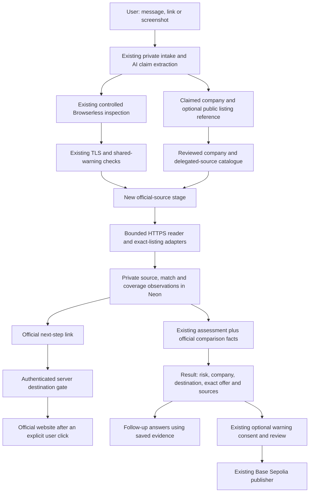

# Scamwin: company, offer and official next-step verification

Date: 10 November 2026. Status: implemented locally after approval; see the [execution record](../../scamwin-official-verification-progress.md). Production activation has not been performed.

## 1. What we are building

After Scamwin examines a suspicious message or website, it should answer three separate questions in simple English: **Do we recognize the company's official sources? Does this destination belong to that company or a reviewed partner? Can we find this exact offer in a public official source?** It should then show the user an official next step, with its destination and supporting evidence visible.

For example, a message may promise a job at a real company and demand a registration fee. Scamwin can find the company's published job listing while still flagging the fee request. The next step is to open the official listing or careers page independently. Finding a real listing does not authenticate the sender, prove a private job offer, or cancel an observed risk.

This extends the challenge's website threat analysis, impersonation detection, source comparison and digital trust intelligence. It keeps the product focused on helping someone decide what to do before paying or sharing information.

## 2. Scope and approach

The first version supports a reviewed set of organizations. It combines a versioned source catalogue with small, live checks of public official pages. Recruitment is the first exact-listing adapter. Other offers, such as refunds and identity requests, receive reviewed official support or policy routes; personal eligibility and private invitation authenticity are not inferred from those routes.

Three approaches were considered:

| Approach | Decision |
| --- | --- |
| Only compare hostnames with a saved list | Keep as rollback behavior; insufficient for checking the offer itself. |
| Reviewed company sources plus bounded live checks | Build this version: clear authority, evidence and predictable resource use. |
| Search the entire web and let AI select official companies | Defer: adds discovery, disambiguation, provider and trust problems to the first release. |

Resume uploads, resume scoring, skill extraction, preferences, job recommendations, job ranking, job matching, automatic applications and recruiter contact are outside this change. Checking a specific public posting is verification of the submitted offer, not a job discovery service. No general crawler, legal-business KYC system or company ownership investigation is added.

## 3. Current implementation and integration points

The current `official-sources.ts` compares a claimed organization and hostname with `SCAMWIN_OFFICIAL_SOURCES_JSON`, requiring a manual review less than 30 days old. It does not fetch an official page or verify a particular listing.

Existing strengths remain: Auth0 account ownership, private Neon checks and evidence, Cloudflare claim extraction and explanations, controlled Browserless observation with an embedded watch-only view, TLS checks, deterministic payment-direction findings, private related-check lookup, and consent/reviewer-controlled Base Sepolia warnings.

The new reader runs inside the existing Vercel investigation. It is separate from Browserless. It reads only catalogue-approved public HTML/JSON, without executing JavaScript or interacting with websites. `SCAMWIN_APPROVED_ORIGINS` continues to restrict the existing browser and origin probe; adding an official source never grants browser permission.

## 4. User journey and wording

1. The user opens **New check** and supplies the existing link, message or screenshots. Two optional fields under an expandable **Company and public offer reference** section allow corrections: **Claimed company** and **Public listing link or posting ID**. Neither field is required. The helper says to omit personal invitation codes and private links.
2. Scamwin extracts claims in the existing AI call. An explicit company field takes priority over an inferred name; a disagreement is recorded as uncertainty. A model-extracted company remains a claim, never proof.
3. The actual progress sequence becomes intake, browser, trust, registry, **official**, comparison, assessment. The new stage says **Checking official sources**. Browser viewing ends when its real session ends; official HTTP checks do not pretend to be visible browser activity.
4. The result retains its existing risk banner and promise/action/destination trace. A new **Company and offer verification** card appears below that trace, before the detailed findings.
5. The card separately displays the company reference, submitted destination, exact offer, checked time and supporting sources. Missing information is an actionable explanation, such as **Start a new check and add the public posting ID to check this exact job**. A link to `/check` opens the existing intake in the same tab, without private details in a URL. Recheck continues to rerun the immutable saved input; it does not edit that input.
6. **Official next step** explains the purpose, destination domain and whether the route was checked live or only manually reviewed. The user explicitly clicks a normal link; navigation occurs in the same tab. No inspection opens a new tab automatically.
7. Follow-up questions use these saved facts. Revisiting a check or asking a question does not fetch official sites again. A fresh investigation uses the existing explicit recheck and quota flow.

Use existing charcoal surfaces, typography, blue links, evidence citations and accessible primitives. Do not introduce a trust percentage or a blanket **Company verified**, **Safe job**, **Guaranteed genuine** or **100% safe** badge.

Example result:

> Official source recognized: Example Company's reviewed careers site.
>
> Submitted destination: not in the reviewed company or partner routes.
>
> Exact offer: published listing 12345 found at the stated check time.
>
> Payment request: the observed registration fee still needs caution.
>
> Official next step: view listing 12345 on the company's reviewed hiring board.

## 5. Authority and catalogue

Use one checked-in, Zod-validated `official-source-catalog.ts`, with a catalogue version and stable company/source IDs. Bound it to 100 companies, eight sources per company and 20 aliases per company. The project maintainer owns review. Each company has a display name, explicitly reviewed aliases, first-party hostnames, `reviewedAt`, `reviewEvidenceUrl`, supported offer types and typed source definitions. Reject invalid entries, duplicate IDs, future review times and unsupported scope definitions. An alias shared by two companies is ambiguous; do not pick the first.

Reviews remain current for **30 days**. Renewing a review requires checking the actual official relationship; updating a date alone is not a renewal. Unknown or expired companies receive verification guidance without a guessed external link.

Source definitions are a discriminated union:

| Kind | Allowed configuration and use |
| --- | --- |
| `official_entry` | An exact HTTPS entry URL and purpose: careers, support, refund or identity help. This provides a reviewed next step and may be read for availability. |
| `greenhouse_job` | A reviewed board token, exact public listing URL template containing one numeric `{postId}`, and a company first-party delegation-evidence URL. The API host and request shape are code-owned. |
| `jobposting_jsonld` | Exact HTTPS origin, a path prefix with segment boundaries, an exact careers fallback URL and first-party relationship evidence. Only a submitted public listing URL within that scope can be read. |

Each delegated source must record evidence that the company actually uses that tenant/board. Shared ATS domains are never trusted wholesale. Company host recognition alone does not approve every hosted page: source paths and tenant scope are evaluated separately. Do not automatically trust subdomains, suffix matches, Unicode lookalikes or URLs contained in AI output.

When the new feature is enabled, the catalogue is its only authority store. Do not merge legacy environment entries into it. When disabled, retain the current hostname-only behavior for rollback, with its current wording. Seed test fixtures with fictional companies. Before production activation, manually review at least one supported real company and one real delegated source; do not invent official relationships to make a demo pass.

## 6. Claims and exact-offer verification

Extend `CheckInput` with optional `claimedCompany` (200 characters) and `offerReference` (4096 characters). Count new text toward the existing 12,000-character combined text limit. Existing link/message/screenshot submissions continue to work. A public offer reference, with or without a company name, counts as submission content; a company name alone does not. A numeric reference without a resolvable company remains insufficient for lookup. Preserve the explicit intended action.

Reuse `OfferIntent.extractedCandidates` for bounded `offer_type`, `job_title` and `job_location` claims. Do not add another model call. Organization aliases resolve through the catalogue; fuzzy/semantic name resemblance cannot establish authority.

Only an explicit public reference field or a submitted URL that matches a reviewed listing scope can supply a reference for outbound lookup. AI-extracted reference codes are display-only suggestions until the user provides them as a public reference. Never send private invitation tokens, a resume, the message, email address, screenshots or a full submitted query string to an official source.

Initial exact lookup rules:

- **Greenhouse:** a numeric public job-post ID and a uniquely resolved reviewed board. If a company has multiple reviewed boards, require a public listing URL that identifies one; a numeric ID alone returns `reference_needed`, with no guessed board or speculative request. Keep post ID distinct from internal job ID and requisition ID. Use the single-post public GET endpoint, not a whole-market or whole-board job search. Construct the destination from the reviewed listing template; do not trust an arbitrary returned `absolute_url`.
- **Static official page:** the exact public URL must satisfy the reviewed origin/path scope. Read a matching `JobPosting` JSON-LD object with a consistent identifier, organization and canonical URL. Multiple conflicting objects or a mismatched canonical URL stay unresolved. Structured data is evidence only after source authority is established.
- Without a usable public reference, return `reference_needed`; do not substitute a similar job title. Title and location comparisons are optional facts about an already identified listing. Compare normalized literal values and report differences for review; do not infer fraud from synonyms, remote-work variants or omitted fields.
- A returned matching public listing means **published listing found at the checked time**. It does not confirm the recruiter or a personal offer. A closed state requires an explicit official closure or a valid explicit deadline in the past. A 404 or missing record means only **not found in the checked source**. Missing, invalid or ambiguous deadlines cannot establish closure.
- Refund/KYC/private offers use `not_publicly_verifiable` and a reviewed support/policy route. Do not claim to have verified personal eligibility or the private request.

## 7. Separate result states

The browser-safe result uses these exact status unions:

| Dimension | Status values |
| --- | --- |
| Company reference | `recognized`, `ambiguous`, `unlisted`, `expired`, `not_claimed` |
| Submitted destination | `first_party_source`, `reviewed_delegate`, `known_domain_unreviewed_path`, `unrecognized`, `not_provided` |
| Offer | `matched_public_reference`, `details_differ`, `explicitly_closed`, `not_found_in_checked_source`, `reference_needed`, `not_publicly_verifiable`, `unavailable`, `not_applicable` |
| Freshness | `fresh`, `stale`, `reference_only`, `not_checked` |

Every affirmative fact points to saved observation IDs and displays provenance. Fresh public listing facts have a **6-hour** current-use window from the real fetch time. Older saved facts remain historical evidence with their original time; do not relabel them as a current confirmation. Catalogue review age and live fetch age are distinct.

An official discrepancy can add a cited inference requiring caution. A positive match never lowers an existing action risk. Missing listings, unlisted organizations, stale references, blocked pages, network errors and absent fields do not independently establish fraud. Remove the old interpretation that an official hostname match independently confirms the entire organization or offer.

## 8. Public-source reader and resource budget

Implement a separate server-only reader using Node 24 HTTPS, DNS and the existing IP-range policy approach. Its production API accepts a validated catalogue source definition and a typed public reference, not an arbitrary URL. The coordinator resolves this definition from the catalogue; the reader revalidates its URL scope before every request.

Read scope and navigation scope are distinct. A Greenhouse read is exactly the code-owned `https://boards-api.greenhouse.io/v1/boards/{boardToken}/jobs/{postId}` resource; its browser destination is the reviewed public listing template. Static-page and entry reads use their reviewed public URL. Store the requested/final read URLs separately from the public listing URL. A valid API URL does not authorize a user-facing redirect, and a valid listing URL does not authorize an arbitrary API request.

Exact limits per investigation:

- At most **2 source documents**, **4 HTTP requests including redirects**, and **1 redirect per document**. No retries or pagination.
- **20 seconds** for the whole official stage, **8 seconds** per request including DNS/body, within the existing **240-second** pipeline deadline. Skip collection if fewer than **55 seconds** remain: up to 20 seconds for collection leaves at least 35 seconds for the existing comparison call and final assessment. These are ceilings, not an extension of worker duration.
- **256 KiB** per response body and **512 KiB** total. Send `Accept-Encoding: identity`; reject encoded responses in v1, so compressed and decoded limits cannot diverge. Accept only HTML or JSON content types required by the selected adapter. A partial/oversized body cannot produce a negative lookup result.
- HTTPS, port 443, normal certificate and hostname validation. No URL credentials, IP-literal targets, fragments, arbitrary query parameters, cookies, authorization, forms, scripts, downloads or login/CAPTCHA bypass.
- Validate catalogue URL scope and public-unicast DNS for every request and redirect. Pin the validated address to the actual HTTP socket while retaining the original hostname for Host/SNI/certificate checks. Do not DNS-check and then call an ordinary re-resolving fetch. Disable unreviewed proxy/environment transport routing.
- Redirects must independently satisfy the reviewed source origin/path/template scope; merely sharing the same registrable domain is insufficient. Reject private/reserved IPv4/IPv6, mixed public/private DNS answers and redirect escapes.

Parse bounded HTML with **parse5 7.3.0** as a declared direct dependency (already present transitively in the lockfile). Read text and `application/ld+json` nodes without executing them. Do not regex-parse arbitrary HTML or render source HTML in Scamwin. A dynamic-only, prohibited or unavailable page yields unavailable coverage; no second Browserless session is started.

Use no shared cross-user cache in v1. Deduplicate the same canonical URL inside one run. Saved observations are the historical cache; refreshing the result does not restart official reads. Respect provider/site access restrictions; an inaccessible source remains unavailable.

## 9. Evidence, storage and privacy

Use existing flat `Observation.data`, not a new verification table or nested `CheckRecord` object. Add at most **8** official observations per run: company reference, destination, up to two source documents, offer comparison, summary, and up to two next-step candidates. Each record uses `sourceKind: official_source`, its real `checkId`/`runId`, collector/policy versions and actual event time.

Store bounded scalar fields, primitive arrays of supporting IDs, public canonical source URL, catalogue version, source ID, review/fetch dates, response category, a body digest and necessary normalized listing fields. Supporting quotations are at most **800 characters** each; extracted text per source is at most **8,000 characters** in memory and is not persisted wholesale. Never store raw HTML or log private submitted content. Source bodies cannot supply instructions, trusted domains or automatic actions.

Derive the UI projection from owned saved observations. Validate all projected shapes, check/run identity, source IDs and current catalogue status. Existing 30-day private-check retention and seven-day image retention remain unchanged. No DB schema change or `db:push` is needed.

Follow-up context selects at most 30 observations, including the up-to-eight official records before lower-priority uncited records. Only provide assessment findings whose cited records are included; enforce a 64 KiB serialized context limit and validate response citations against the actual provided subset. The existing page comparison remains restricted to its real `live_page` evidence; official HTTP data is never mislabeled to enter it.

Official-source records alone remain ineligible as target-side evidence for publishing a warning. No automatic public sharing, approval or Web3 write is introduced.

## 10. Official next-step behavior

Provide at most two distinct next steps: the exact public listing, when fresh and not explicitly closed, and a reviewed careers/support/refund/identity-help fallback. If the company is unknown or ambiguous, show manual verification instructions with no invented link. If an exact listing has concerning observed behavior, label it as a place to independently verify details, not a recommendation to proceed or pay.

Each candidate has a random `stepId`, source ID, purpose, canonical URL, label, destination hostname, evidence IDs, catalogue version and expiry saved in a flat observation. A listing step expires at the earliest of fetch time + six hours, known valid deadline, catalogue review expiry or private check expiry. A reviewed-entry step expires at catalogue review expiry or check expiry; its label must distinguish **reviewed route, not checked live** when appropriate.

Save the typed public reference as flat reference-kind/value/origin fields with a listing step. On click, reconstruct the exact expected navigation URL from that reference and the current source definition and require equality with the saved destination, rather than merely accepting any path within the source's general scope.

Render a plain, non-prefetched link through an authenticated route:

`GET /api/scamwin/checks/{checkId}/official-next-step/{stepId}`

The route resolves the owner from Auth0, loads the owned check and matching saved candidate, requires a completed/partial current run, checks expiry and revalidates against the current catalogue. It takes no destination URL or owner ID from the client. On success, return a 303 redirect to that same validated canonical destination, with `Cache-Control: private, no-store` and `Referrer-Policy: no-referrer`. Do not forward authentication, cookies or private query strings. Raw source URLs in the evidence UI remain inert text; only explicit gated next-step links navigate to official sites.

An invalid or expired owned candidate returns the user to their check with a fixed `officialStep=unavailable` notice; do not silently choose a different destination. Unauthenticated/unowned requests use existing authentication/not-found handling. Revalidate a source on click without making another external request; catalogue revocation immediately removes permission even for a previously saved candidate. A changed catalogue version requires recheck rather than treating old authority as current.

## 11. Stack, setup and rollout

Reuse Next.js/TypeScript, Node 24, Zod, Auth0, Neon, Cloudflare Workers AI, Browserless and the current Vercel worker. Add only the direct parse5 dependency. Public Greenhouse GET data does not require an API key; this feature does not use its application submission API. No new service account, Google OAuth, search key, Trigger.dev deployment or paid fallback is required.

Add one main-project Config variable, `SCAMWIN_OFFICIAL_VERIFICATION_ENABLED`, default `false`. Enable `true` in **Production only** after tests and reviewed catalogue entries are ready. Preview testing should use fictional injected fixtures, with no production credentials copied. Existing secrets and browser flags stay unchanged. Never put catalogue or transport modules into the separate publisher runtime.

Roll out behind the flag: local fixture tests, main/publisher build verification, manual source review, a bounded opt-in public-source acceptance check, production deployment under existing authorization rules, then an owned-account smoke test. Rollback disables the flag and restores the present hostname-only path; saved new evidence stays historical and new official navigation is disabled.

## 12. Acceptance and non-goals for this release

The release is accepted when a current reviewed company and exact listing produce cited, separately labeled facts and a working official step; a copied real listing plus scam fee retains its risk; wrong ATS tenant, unknown company, unavailable source and missing reference produce honest coverage; next-step URLs cannot escape source scope or cross account/run boundaries; cancellation stops official I/O and late writes; and all existing browser, risk, warning and publisher checks pass.

No new claims about full TLS transparency, all companies, all ATS systems, guaranteed authenticity, private eligibility, resume suitability or hiring success are made. These are scope boundaries for implementation, not extra features to build now.

## References checked for this design

- [Greenhouse Job Board API](https://docs.greenhouse.io/job-board): public GET lookup and post-ID semantics; application POST is separate.
- [Schema.org JobPosting](https://schema.org/JobPosting): public structured listing fields, organization and validity dates.
- [Node 24 HTTPS](https://nodejs.org/download/release/latest-v24.x/docs/api/https.html): request/agent and TLS connection controls.
- [parse5](https://parse5.js.org/): non-executing HTML parsing API.
